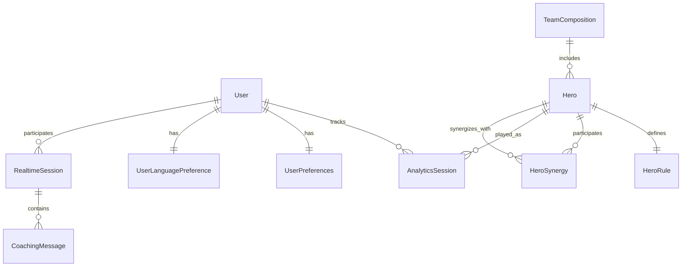

# Data Model Design: MLBB Coach AI Enhancement Opportunities

**Date**: 2025-09-09  
**Feature**: MLBB Enhancement Opportunities  
**Status**: Complete ✅

## Core Entity Models

### 1. Enhanced Hero Rule System

```python
@dataclass
class HeroSkill:
    """Individual hero skill definition"""
    id: str
    name: str  
    analysis_function: str
    cooldown: Optional[float] = None
    mana_cost: Optional[int] = None
    metadata: Dict[str, Any] = field(default_factory=dict)

@dataclass  
class HeroRule:
    """Enhanced hero-specific coaching rules"""
    hero_id: str
    hero_name: str
    role: str  # tank, fighter, assassin, mage, marksman, support
    skills: Dict[str, HeroSkill]
    analysis_rules: List[Dict[str, Any]]
    performance_thresholds: Dict[str, float]
    created_at: datetime
    updated_at: datetime
    version: str = "1.0"
    
    # New fields for expansion
    synergies: List[str] = field(default_factory=list)  # Compatible heroes
    counters: List[str] = field(default_factory=list)   # Counter heroes
    meta_tier: str = "B"  # S, A, B, C tier classification
    difficulty: int = 3   # 1-5 difficulty rating
```

### 2. Time-Series Analytics System

```python
@dataclass
class AnalyticsSession:
    """Time-series performance tracking"""
    session_id: str
    user_id: str
    hero_id: str
    timestamp: datetime
    
    # Core performance metrics
    kda_ratio: float
    gpm: float  # Gold per minute
    hero_damage: int
    turret_damage: int
    damage_taken: int
    teamfight_participation: float
    
    # Match context
    match_duration: int  # seconds
    game_mode: str
    rank_tier: Optional[str] = None
    region: Optional[str] = None
    
    # Coaching results
    coaching_feedback: List[Dict[str, Any]] = field(default_factory=list)
    improvement_score: Optional[float] = None
    
    # Aggregation support
    aggregation_period: str = "raw"  # raw, hourly, daily, weekly
    
class PerformanceTrend:
    """Aggregated performance analytics"""
    user_id: str
    hero_id: str
    period_start: datetime
    period_end: datetime
    
    # Trend metrics
    avg_kda: float
    avg_gpm: float
    games_played: int
    win_rate: float
    improvement_rate: float  # % change from previous period
    
    # Ranking comparisons
    percentile_rank: Optional[float] = None
    rank_tier_progress: Optional[str] = None
```

### 3. Real-time Coaching System

```python
@dataclass
class RealtimeSession:
    """WebSocket coaching session management"""
    session_id: str
    user_id: str
    connection_id: str
    hero_id: Optional[str] = None
    
    # Session state
    status: str = "active"  # active, paused, ended
    started_at: datetime = field(default_factory=datetime.now)
    last_activity: datetime = field(default_factory=datetime.now)
    
    # Coaching context
    coaching_preferences: Dict[str, Any] = field(default_factory=dict)
    current_game_phase: str = "early"  # early, mid, late
    
class CoachingMessage:
    """Real-time coaching messages"""
    message_id: str
    session_id: str
    timestamp: datetime
    
    # Message content
    message_type: str  # tip, warning, suggestion, encouragement
    content: str
    priority: int = 1  # 1-5, higher = more important
    
    # Localization
    language: str = "en"
    translated_content: Optional[Dict[str, str]] = None
    
    # Delivery tracking
    delivered: bool = False
    acknowledged: bool = False
```

### 4. Multi-language Support

```python
@dataclass
class LocalizationEntry:
    """Multi-language content management"""
    key: str
    namespace: str  # ui, heroes, skills, coaching
    source_language: str = "en"
    
    # Translations
    translations: Dict[str, str] = field(default_factory=dict)
    
    # Context for translators
    context: Optional[str] = None
    character_limit: Optional[int] = None
    
    # Metadata
    created_at: datetime = field(default_factory=datetime.now)
    updated_at: datetime = field(default_factory=datetime.now)
    version: int = 1

@dataclass
class UserLanguagePreference:
    """User language and cultural preferences"""
    user_id: str
    primary_language: str = "en"
    fallback_language: str = "en"
    
    # Cultural adaptations
    coaching_style: str = "direct"  # direct, encouraging, detailed
    formality_level: str = "casual"  # formal, casual, friendly
    
    # UI preferences
    date_format: str = "MM/DD/YYYY"
    number_format: str = "en-US"
    timezone: str = "UTC"
```

### 5. Team Analysis System

```python
@dataclass
class TeamComposition:
    """Team synergy and composition analysis"""
    composition_id: str
    heroes: List[str]  # 5 hero IDs
    
    # Analysis results
    synergy_score: float  # 0-100
    balance_score: float  # Role distribution balance
    meta_score: float     # Current meta compatibility
    
    # Detailed analysis
    role_distribution: Dict[str, int]
    synergy_pairs: List[Tuple[str, str, float]]
    counter_vulnerabilities: List[str]
    
    # Recommendations
    strengths: List[str]
    weaknesses: List[str]
    strategy_recommendations: List[str]
    
    created_at: datetime = field(default_factory=datetime.now)

@dataclass
class HeroSynergy:
    """Hero-to-hero synergy relationships"""
    hero_a: str
    hero_b: str
    synergy_score: float  # -100 to 100 (negative = counter)
    
    # Synergy details
    combo_potential: float
    lane_compatibility: float
    team_fight_synergy: float
    
    # Meta context
    patch_version: str
    last_updated: datetime = field(default_factory=datetime.now)
```

### 6. User Preferences and Configuration

```python
@dataclass
class UserPreferences:
    """Enhanced user configuration"""
    user_id: str
    
    # Coaching preferences
    coaching_frequency: str = "normal"  # minimal, normal, detailed
    focus_areas: List[str] = field(default_factory=list)  # mechanics, strategy, positioning
    
    # Real-time settings
    realtime_enabled: bool = False
    notification_types: List[str] = field(default_factory=list)
    
    # Analytics preferences
    comparison_tier: Optional[str] = None  # Compare against specific rank
    privacy_level: str = "standard"  # minimal, standard, full
    
    # Mobile optimizations
    image_quality: str = "auto"  # low, medium, high, auto
    offline_mode: bool = True
    
    updated_at: datetime = field(default_factory=datetime.now)
```

### 7. OCR Analysis and Parsing Models

```python
@dataclass
class OCRExtractionResult:
    """Comprehensive OCR extraction results"""
    session_id: str
    timestamp: datetime
    
    # Player identification
    ign: Optional[str] = None
    player_located: bool = False
    detection_method: str = "none"  # exact_match, fuzzy_match, visual_anchor, mvp_fallback
    
    # Core game data
    hero: Optional[str] = None
    role: Optional[str] = None
    kda: Optional[Dict[str, int]] = None  # {k: int, d: int, a: int}
    gpm: Optional[float] = None
    gold: Optional[int] = None
    mvp_score: Optional[float] = None
    match_duration_min: Optional[float] = None
    
    # Damage metrics (from damage view)
    damage: Optional[Dict[str, float]] = None  # {hero_pct, taken_pct, turret}
    teamfight_pct: Optional[float] = None
    
    # Quality metrics
    view_confidences: Dict[str, float] = field(default_factory=dict)  # kda_view, damage_view
    overall_confidence: float = 0.0
    data_completeness: float = 0.0
    
    # Error tracking
    warnings: List[str] = field(default_factory=list)
    missing_fields: List[str] = field(default_factory=list)
    
    # Raw OCR data for debugging
    ocr_text_kda: Optional[str] = None
    ocr_text_damage: Optional[str] = None

@dataclass
class PlayerDetectionResult:
    """Player row detection results with fallback chain"""
    found: bool = False
    row_index: Optional[int] = None
    detection_method: str = "none"
    confidence: float = 0.0
    
    # Detection details
    ign_match: Optional[str] = None
    similarity_score: Optional[float] = None
    visual_anchors: List[str] = field(default_factory=list)  # [avatar, flag, level, mvp]
    
    # Alternative candidates
    candidate_rows: List[Dict[str, Any]] = field(default_factory=list)
    fallback_reason: Optional[str] = None

@dataclass
class RegionDetectionResult:
    """Table region detection for KDA and Damage views"""
    kda_region: Optional[Tuple[int, int, int, int]] = None  # (x, y, w, h)
    damage_region: Optional[Tuple[int, int, int, int]] = None
    
    # Anchor detection
    anchors_found: List[str] = field(default_factory=list)
    anchor_confidence: float = 0.0
    
    # Template matching results
    template_matches: Dict[str, float] = field(default_factory=dict)
    
@dataclass
class CrossViewFusionResult:
    """Results from fusing KDA and Damage view data"""
    primary_view: str  # kda or damage
    secondary_view: str
    
    # Fusion confidence
    fusion_confidence: float = 0.0
    consistency_score: float = 0.0
    
    # Data conflicts
    conflicts: List[Dict[str, Any]] = field(default_factory=list)
    resolutions: List[str] = field(default_factory=list)
    
    # Final merged data
    merged_result: OCRExtractionResult

@dataclass
class OCRProcessingMetrics:
    """Performance and quality metrics for OCR processing"""
    session_id: str
    processing_time_ms: float
    
    # Stage timings
    stage_timings: Dict[str, float] = field(default_factory=dict)  # {ocr, detection, parsing, fusion}
    
    # Quality metrics
    ocr_confidence: float = 0.0
    text_clarity: float = 0.0
    template_match_quality: float = 0.0
    
    # Error counts
    correction_count: int = 0
    fallback_count: int = 0
    warning_count: int = 0
```

### 8. OCR Configuration and Rules

```python
@dataclass
class OCRConfiguration:
    """OCR processing configuration and thresholds"""
    # Detection thresholds
    exact_match_threshold: float = 1.0
    fuzzy_match_threshold: float = 0.88
    visual_anchor_threshold: float = 0.7
    
    # Template matching
    template_confidence_threshold: float = 0.8
    anchor_templates: Dict[str, str] = field(default_factory=dict)
    
    # Text normalization rules
    text_corrections: Dict[str, str] = field(default_factory=dict)
    numeric_patterns: List[str] = field(default_factory=list)
    
    # Parsing rules
    kda_regex_patterns: List[str] = field(default_factory=list)
    score_patterns: List[str] = field(default_factory=list)
    duration_patterns: List[str] = field(default_factory=list)
    
    # Quality gates
    minimum_confidence: float = 0.5
    minimum_completeness: float = 0.6
    required_fields: List[str] = field(default_factory=list)
    
    updated_at: datetime = field(default_factory=datetime.now)
    version: str = "1.0"

@dataclass
class KnownPlayerProfile:
    """Known player information for improved detection"""
    ign: str
    user_id: Optional[str] = None
    
    # Alternative spellings from OCR errors
    ign_variants: List[str] = field(default_factory=list)
    
    # Visual characteristics
    typical_level_range: Tuple[int, int] = (1, 30)
    common_heroes: List[str] = field(default_factory=list)
    region_indicators: List[str] = field(default_factory=list)  # flag codes
    
    # Historical context
    last_seen: datetime = field(default_factory=datetime.now)
    match_count: int = 0
    detection_success_rate: float = 0.0
```

## Database Schema Design

### TimescaleDB Tables

```sql
-- Time-series analytics optimized
CREATE TABLE analytics_sessions (
    session_id VARCHAR(36) PRIMARY KEY,
    user_id VARCHAR(36) NOT NULL,
    hero_id VARCHAR(50) NOT NULL,
    timestamp TIMESTAMPTZ NOT NULL,
    
    -- Performance metrics
    kda_ratio FLOAT NOT NULL,
    gpm FLOAT NOT NULL,
    hero_damage INTEGER NOT NULL,
    turret_damage INTEGER NOT NULL,
    damage_taken INTEGER NOT NULL,
    teamfight_participation FLOAT NOT NULL,
    
    -- Match context
    match_duration INTEGER NOT NULL,
    game_mode VARCHAR(50) NOT NULL,
    rank_tier VARCHAR(20),
    region VARCHAR(10),
    
    -- Coaching data (JSONB for flexibility)
    coaching_feedback JSONB DEFAULT '[]',
    improvement_score FLOAT
);

-- Convert to TimescaleDB hypertable
SELECT create_hypertable('analytics_sessions', 'timestamp');

-- Create continuous aggregates for common queries
CREATE MATERIALIZED VIEW analytics_hourly
WITH (timescaledb.continuous) AS
SELECT 
    time_bucket('1 hour', timestamp) AS hour,
    user_id,
    hero_id,
    AVG(kda_ratio) as avg_kda,
    AVG(gpm) as avg_gpm,
    COUNT(*) as games_played
FROM analytics_sessions
GROUP BY hour, user_id, hero_id;
```

### Redis Data Structures

```python
# Real-time session management
redis_patterns = {
    "realtime_session:{session_id}": "Hash with session data",
    "user_sessions:{user_id}": "Set of active session IDs", 
    "coaching_queue:{session_id}": "List of pending messages",
    "hero_rules:{hero_id}": "Hash with cached rule data",
    "localization:{lang}:{namespace}": "Hash with translations"
}
```

## Data Validation Rules

### Hero Rules Validation
- Hero ID must match official MLBB hero roster
- Analysis functions must exist in coaching engine
- Performance thresholds must be within realistic ranges
- Synergy/counter lists must reference valid heroes

### Analytics Validation  
- KDA ratio: 0.0 - 50.0 (extreme outliers capped)
- GPM: 50 - 2000 (reasonable bounds for all roles)
- Damage values: Non-negative integers
- Match duration: 120 - 3600 seconds (2 minutes to 1 hour)

### Localization Validation
- Translation keys must follow namespace.component.field format
- Character limits enforced for UI elements  
- Required fields validated for each supported language
- Context descriptions required for complex game terms

## Migration Strategy

### Phase 1: Core Model Extensions
1. Extend existing `HeroRule` model with new fields
2. Create `AnalyticsSession` table with TimescaleDB
3. Add localization tables and seed with English content

### Phase 2: Real-time Infrastructure
1. Add real-time session models and Redis structures
2. Implement WebSocket message schemas
3. Create team analysis models

### Phase 3: Advanced Features
1. Complete localization for target languages
2. Implement advanced analytics aggregations
3. Add user preference models

## Data Relationships



## Performance Considerations

### Indexing Strategy
- TimescaleDB automatic time-based partitioning
- Composite indexes on (user_id, hero_id, timestamp)
- GIN indexes on JSONB coaching_feedback fields
- Partial indexes for active real-time sessions

### Caching Strategy
- Hero rules cached in Redis with 1-hour TTL
- User preferences cached with 24-hour TTL
- Analytics aggregations cached with 15-minute TTL
- Localization content cached indefinitely with version invalidation

### Data Retention
- Raw analytics: 2 years
- Hourly aggregates: 5 years  
- Daily aggregates: Indefinite
- Real-time sessions: 30 days
- Coaching messages: 90 days

This data model provides the foundation for all planned enhancement features while maintaining performance and scalability requirements.